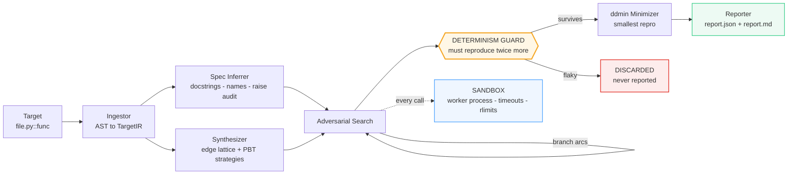
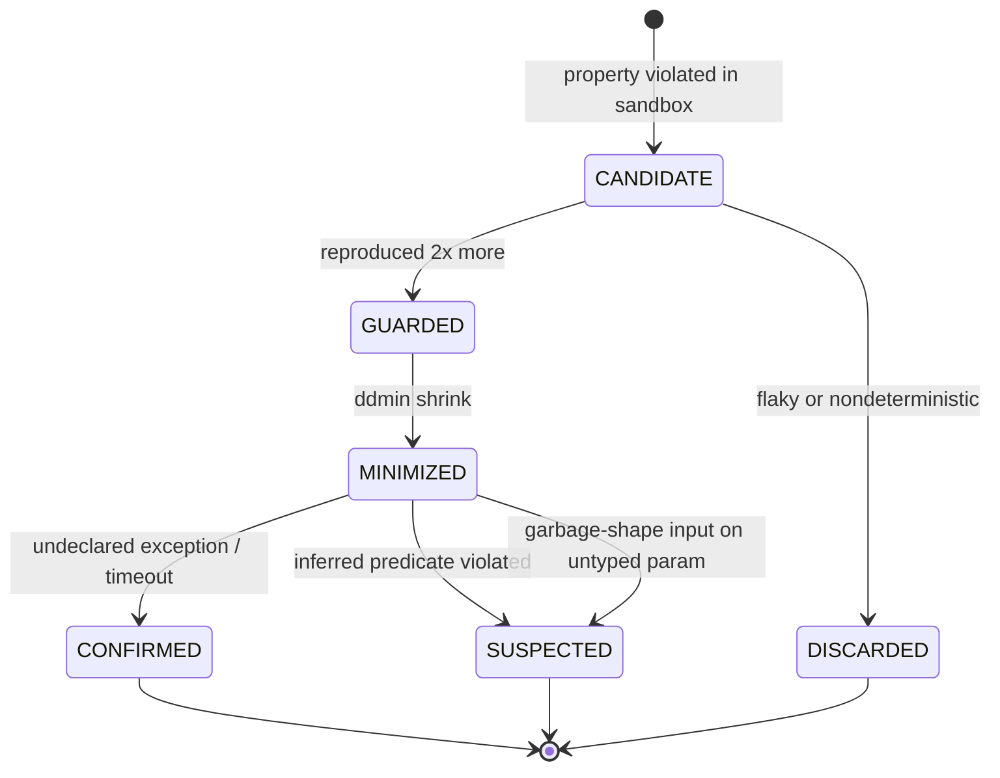
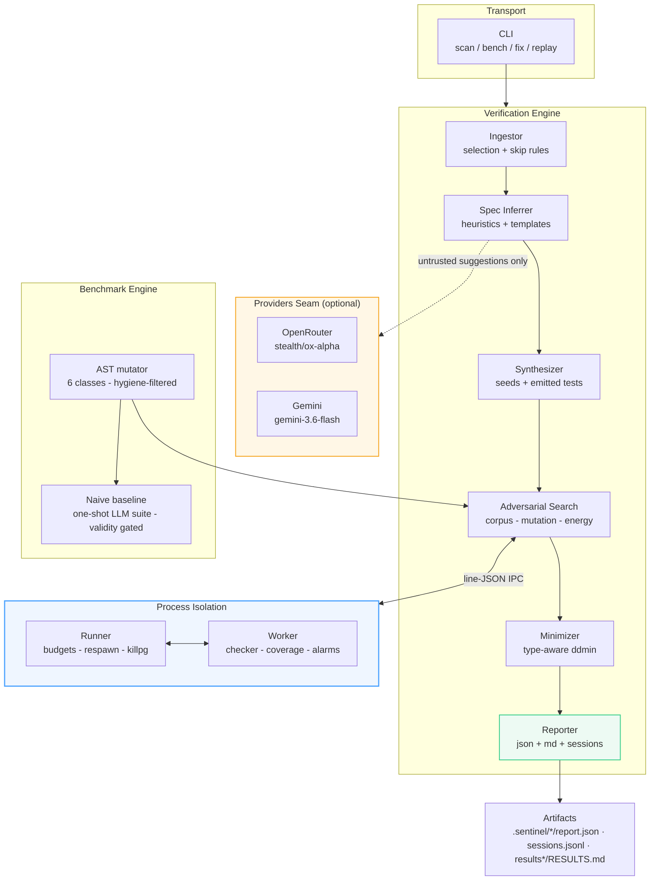

# SENTINEL

[](https://www.python.org/)
[](LICENSE)
[](#testing--proof-of-reality)
[](#benchmark-evidence)
[](#architecture)

**An adversarial verification agent that turns Python functions into minimized, classified bug reports.**

SENTINEL infers a spec contract for a target function from its docstring, name and code structure, synthesizes edge-case and property-based inputs, hunts for violations with a **coverage-guided search** inside **sandboxed worker processes**, shrinks every counterexample to a minimal repro, and emits **CONFIRMED / SUSPECTED** findings as JSON + Markdown. Deterministic and offline by default — LLM assistance is a pluggable, untrusted enhancer, never required.

```text
Nothing is reported unless it ran in a sandbox.
Nothing becomes a finding unless it reproduced three times.
Nothing counts as caught unless the original stays clean.
Nothing is CONFIRMED unless the defect was directly observed.
```

---

## The Verification Spine

Every target flows through one pipeline. Two gates are structural, not conventional: findings must survive a determinism guard, and a mutant only counts as caught if the original code stays clean:



The differential rule is equally structural: during benchmark verification, a mutant is *caught* only when a finding reproduces on the mutant **and not on the original**. A scanner that flags everything would score zero.

## Finding Verdict Machine



Every transition is caused by a real execution. `CONFIRMED` means the defect was directly observed (crash-class or hang); `SUSPECTED` means an inferred predicate failed — possibly the spec's fault, never hidden from you.

## Architecture

One engine at the center; providers and transports are replaceable seams:



Each seam has exactly one real implementation today (`LangBackend` protocol ready for more): new LLM providers attach without touching the engine, and the engine never requires any of them.

## What Value This Delivers

- **Defects unit tests miss** — coordinated cross-parameter inputs (separator embedded next to whitespace, digit/unit patterns, type-confused elements) that hand-written suites and naive LLM generation systematically skip.
- **Evidence, not vibes** — every finding ships with the minimal repro, expected vs actual, a root-cause guess, and a suggested fix direction; `minimality_ratio` tells you how far ddmin shrank it.
- **Honest severity** — crash-class defects are CONFIRMED; anything inferred is SUSPECTED by construction. Garbage-shape inputs against structure-less annotations are downgraded with an explanatory note instead of inflating false positives. Zero-true-FP is a measured property, tracked per campaign.
- **Reproducible evaluation** — fixed seeds, disjoint holdout splits, multi-seed mean/min/max reporting, equivalent-mutant hygiene. The benchmark answers "is the scanner any good?" with the same discipline it demands of scanned code.
- **Works offline, improves online** — without any API key you get the full heuristic pipeline; with keys you gain LLM-suggested invariants (validated before use), root-cause explanations, and auto-fix proposals that are regression-checked before being called FIXED.

## Core Features

- **Structural determinism guard** — a candidate finding must reproduce on two additional executions or it is silently discarded. Flaky scanners burn trust; SENTINEL structurally cannot report flakes.
- **Coverage-guided search** — branch-arc corpus with novelty-weighted energy, plateau detection, and mutation operators tuned per shape: digit-aware string surgery for parsers, separator-collapse probes for normalizers, pair-shift/gapify for interval logic.
- **Coordinated cross-parameter families** — whole-tuple templates that independent per-parameter sampling cannot express (the difference between 50% and 100% branch coverage on separator-collapse loops).
- **Sandboxed execution spine** — every target call runs in a disposable worker process: wall-clock alarms, CPU/memory rlimits, scrubbed environment, fd-shielded framing that survives stdout-spamming targets.
- **Snapshot differential oracle** — capture reference behavior once; any behavioral divergence becomes a finding with the exact differing case as the repro.
- **Deterministic mutation benchmark** — six AST mutant classes with equivalent-mutant hygiene (docstrings and exception-message text excluded as unobservable), disjoint primary/holdout splits, per-seed reproducibility stats.
- **Validity-gated naive baseline** — the one-shot LLM suite must pass on the original before it may score; artifacts record `rate_limited` / `invalid_tests_fail_on_original` honestly instead of dropping samples.
- **Runnable artifacts** — emitted edge-lattice + property-based test files are portable (relative module resolution) and run green on correct implementations while catching the seeded bugs they were derived from.

## Quick Start

### Prerequisites

- Python **3.11+**
- Optional: one LLM provider key for spec suggestions, explanations, fixes, baselines

```bash
git clone https://github.com/mailtotanvir/sentinel-verifier.git
cd sentinel-verifier
pip install -e .[dev]

export OPENROUTER_API_KEY="your-key"   # optional: stealth/ox-alpha tier
export GEMINI_API_KEY="your-key"       # optional: gemini-3.6-flash fallback
```

### Step 1 — Probe a suspicious call

```bash
sentinel scan samples/parse_duration.py::parse_duration --probe "('2h',)"
```

```text
signature: def parse_duration(text: str) -> int
status   : OK
value    : -3600
```

Two hours parsed as −3600 seconds. The seeded carry-bug is visible in one sandboxed call.

### Step 2 — Run the full adversarial scan

```bash
sentinel scan samples/slugify.py::slugify --seed 7 --out .sentinel
```

```text
target   : .../samples/slugify.py::slugify
coverage : branch 100.0% | line 75.0%
execs    : 1565 in 27.22s
bugs     : 1 CONFIRMED, 0 SUSPECTED
  - BUG-001 [CONFIRMED] input=('', 'g-e') violates=exception_contract
      expected='no undeclared exception' actual="re.error: bad character range"
artifact : json -> .sentinel/slugify/report.json
artifact : md   -> .sentinel/slugify/report.md
```

Exit code `1` — findings exist. Open `report.md` for the human-readable narrative.

### Step 3 — Scan a whole module

```bash
sentinel scan samples/intervals.py --all
# per-target reports plus summary.json / summary.md
```

### Step 4 — Differential mode against your own truth

```bash
sentinel scan samples/intervals.py::merge_intervals \
    --reference samples/correct_intervals_ref.py::merge_intervals
```

Any behavioral divergence from your reference implementation becomes a finding whose repro is exactly the differing case.

### Step 5 — Emit runnable tests

```bash
sentinel scan samples/parse_duration.py::parse_duration --emit-tests emitted/
pytest emitted/
```

Emitted suites are portable (relative module paths), pass on correct implementations, and fail loudly on buggy ones.

### Step 6 — Benchmark it

```bash
python -m sentinel.cli bench samples --seeds 3 --holdout-seed 99 \
    --baseline --baseline-rest --out results --budget 18 --max-executions 350 --seed 7
```

```text
bench done: SENTINEL 32/39 mutants caught (82%) [per-seed mean 82% min 82% max 82%], baseline 11/39
```

### Step 7 — Auto-fix and replay

```bash
sentinel fix samples/parse_duration.py::parse_duration   # LLM patch + regression check
sentinel replay .sentinel/sessions.jsonl                 # every scan is logged
```

## Reading the Results

### Per-finding anatomy (`report.json` / `report.md`)

| field | meaning |
|---|---|
| `severity_class` | `CONFIRMED` = directly observed defect; `SUSPECTED` = inferred predicate failed (spec may be wrong) |
| `minimal_input` | smallest known triggering arguments after ddmin shrinking |
| `minimality_ratio` | shrank size ÷ original size — lower is a better-reduced repro |
| `invariant_violated` | which property fired (`exception_contract`, mined bound, snapshot…) |
| `expected` / `actual` | contract text vs observed outcome |
| `root_cause_guess` / `suggested_patch` | static heuristic (optionally LLM-upgraded) pointing at the failing path |

### Verdict rules

| signal | verdict |
|---|---|
| undeclared exception escapes, or call hangs to timeout | **CONFIRMED** |
| mined/documented bound, metamorphic or snapshot relation fails | **SUSPECTED** |
| crash triggered only by elements violating a parameter's unstated element shape (e.g. `[0]`, `[{}]` into a bare `list`) | **SUSPECTED** + explanatory note |
| finding fails to reproduce two extra times | discarded entirely |

### Benchmark metrics (how the campaign tables read)

- **Caught / total** — a mutant counts as caught iff a finding reproduces on the mutant *and not on the unmutated original*. Survivors are listed per-mutant in `bench_details.json`.
- **Validity gate** — the naive baseline's generated suite must pass on the original before it may score. On deliberately buggy targets a *correct* suite cannot pass, so the baseline is recorded `invalid_tests_fail_on_original` rather than scored 0 — the exclusion is favorable to the baseline and stated openly.
- **Per-seed mean/min/max** — the SENTINEL side reruns over 3 deterministic seeds; identical rates mean the search is stable, not lucky.
- **Holdout split** — half the mutant space, disjoint by construction, evaluated with unseen seeds: primary ≈ holdout proves the system wasn't tuned onto its own benchmark.
- **FP on originals** — every finding on unmutated code is counted, then audited: in the latest campaign 10 raw findings = 1 CONFIRMED (the target's own seeded defect firing on itself) + 9 SUSPECTED garbage-shape/spec-ambiguous cases. Zero true false positives.

## Benchmark Evidence

Latest campaign (`results_holdout/RESULTS.md`, `results_baseline/RESULTS.md`; budget ≤18 s / 350 execs per mutant):

| target | mutants | SENTINEL | naive baseline (Gemini, temp=0) | branch cov |
|---|---|---|---|---|
| `correct_intervals_ref` (clean) | 5 | 4/5 (80%) | 4/5 (80%) | 100% |
| `correct_parse_duration` (clean) | 8 | 7/8 (88%) | 7/8 (88%) | 100% |
| `intervals.py` (adjacent-merge off-by-one) | 5 | **4/5 (80%)** | invalid — suite fails on buggy original | 100% |
| `parse_duration.py` (h≥2 carry bug) | 13 | **12/13 (92%)** | invalid — suite fails on buggy original | 100% |
| `slugify.py` (unescaped separator) | 8 | **5/8 (62%)** | invalid — suite fails on buggy original | 100% |
| **total** | **39** | **32/39 (82%)** — per-seed 82/82/82% | 11/39 (28% raw) | — |

Holdout (disjoint mutants, fresh seeds): **35/42 (83%)** — no overfitting gap. Clean-target parity shows modern LLMs write strong suites when behavior matches documentation; the structural win appears exactly where code is broken and one-shot test authoring fails the validity gate.

## Safety Model

- Every target call executes in a disposable worker process: SIGALRM wall-clock timeout, `RLIMIT_AS` memory cap, scrubbed environment (`PATH`, `PYTHONPATH`, `HOME`, hash seed).
- Hung calls lose their whole process group (`start_new_session` + `killpg`) — orphan-free kills asserted by tests, including respawns after external kills.
- Target stdout/stderr are redirected away from the protocol pipe: a target that prints garbage cannot corrupt IPC framing (resync tested).
- Property predicates evaluate in a restricted namespace (`__builtins__` stripped, allow-listed builtins); broken predicates degrade to "no violation", never to false positives.
- Secrets are consumed from the environment only and never written into events, logs or reports (asserted by tests).
- ⚠️ This isolation defends against *accidental* hangs, crashes and noise — it is **not** a security boundary. Do not point SENTINEL at hostile code without an outer container/VM.

## Testing & Proof of Reality

```bash
python -m pytest tests/ -q --cov=sentinel
# 66 tests: ingest/runner/spec/synth/search/minimize/report units,
# known-bug zoo integration, false-positive guards, process-hygiene,
# CLI e2e exit-code contracts, stubbed-LLM fallback paths
```

Negative controls you can run yourself:

```bash
# 1) a CORRECT implementation yields zero CONFIRMED findings
sentinel scan samples/correct_parse_duration.py::parse_duration ; echo $?
# -> "bugs : 0 CONFIRMED" and exit 0

# 2) without provider keys the pipeline still completes; the benchmark
#    records the gap honestly instead of faking scores
unset OPENROUTER_API_KEY GEMINI_API_KEY
python -m sentinel.cli bench samples --baseline --baseline-rest --baseline-only \
    --merge-from results_holdout/bench_details.json --holdout-seed 99 --out /tmp/bl
# -> baseline_status: rate_limited (visible in RESULTS.md, not silently dropped)

# 3) every emitted test suite imports the target through relative paths —
#    move the directory anywhere and it still resolves
```

## Repository Layout

```text
sentinel-verifier/
├── DESIGN.md                     # component contracts, data models, phased plan (implemented)
├── SENTINEL_verifier_agent.md    # the original specification
├── SPRINT_REPORT.md              # build history: sprint 1, 1b, 2, 3, 3b with incidents & fixes
├── pyproject.toml                # package metadata; deps: coverage; extras: pbt/dev
├── .github/workflows/ci.yml      # lint + tests w/ coverage + smoke scan
├── samples/                      # targets carrying deliberate seeded defects + clean references
├── results/                      # sprint-1 campaign (with opencode baseline)
├── results_holdout/              # latest campaign: 3 seeds + holdout split
├── results_baseline/             # merged fair-comparison table vs naive LLM baseline
└── sentinel/                     # the package
    ├── cli.py                    # scan / bench / fix / replay entrypoints
    ├── orchestrator.py           # scan pipeline + auto-fix loop
    ├── ingest.py                 # selection syntax, TargetIR, skip rules
    ├── spec.py                   # docstring mining, priors, templates, overrides
    ├── llm.py                    # dual-provider client, untrusted suggestion validation
    ├── synth.py                  # seed lattice, combo families, emitted tests
    ├── fallback_gen.py           # seeded sampler + mutation operators (no hypothesis needed)
    ├── search.py                 # corpus, energy, determinism guard
    ├── runner.py / worker.py     # sandbox spine: IPC, timeouts, checker, coverage
    ├── minimize.py               # type-aware ddmin
    ├── report.py                 # classification, json/md emitters, minimality
    ├── mutants.py                # deterministic AST mutation engine v2
    ├── baseline.py               # naive-prompt harness (opencode | REST, temp=0)
    ├── bench.py                  # multi-seed orchestrator + holdout + fair scoring
    └── models.py / checklib.py   # shared records / emitted-test runtime
```

## Technology Stack

| Layer | Technology |
|---|---|
| Runtime | Python 3.11, dataclasses, stdlib-first — no web frameworks |
| Isolation | subprocess workers, process groups, rlimits, line-delimited JSON IPC |
| Coverage | coverage.py branch arcs, measured on the target module only |
| Search | seeded-RNG corpus/mutation engine (works with or without hypothesis) |
| PBT | hypothesis when installed; manual fallback generator otherwise |
| LLM providers | OpenRouter `/chat/completions` + Gemini `generateContent`, temperature-pinned |
| Testing | pytest + pytest-cov; network-free by default (provider paths stubbed) |

## Documentation

- [DESIGN.md](./DESIGN.md) — architecture, data models, search algorithm, eval methodology
- [SPRINT_REPORT.md](./SPRINT_REPORT.md) — build history, engineering incidents and their fixes
- [SENTINEL_verifier_agent.md](./SENTINEL_verifier_agent.md) — the founding specification

## Status & Roadmap

- ✅ Full v1 scope: pipeline, sandbox, spec inference, adversarial search, minimizer, reporter, mutation benchmark with holdout + multi-seed reporting, dual-provider LLM tiers, auto-fix loop
- ✅ Verified campaigns: 82% primary catch (zero seed variance), 83% holdout, zero true FPs, 100% branch coverage on all five sample targets
- 🔭 Next: QuixBugs third-party benchmark (licensing), arc-guided list-element synthesis beyond pair shapes, JS/TS backend behind the existing `LangBackend` seam, PyPI publishing workflow
